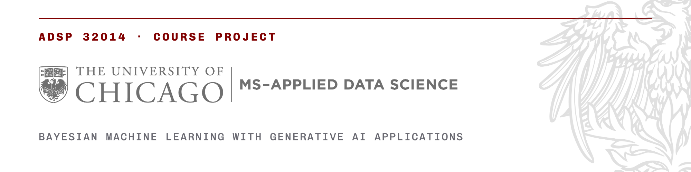

<picture>
  <source media="(prefers-color-scheme: dark)" srcset=".github/assets/banner-dark.png">
  
</picture>

# Deepfake Detection with Bayesian Uncertainty Quantification

> **Example project from Winter 2026.** This is a copy of [khalil-he/Deepfake-Bayesian-Detection](https://github.com/khalil-he/Deepfake-Bayesian-Detection), shown with the authors' work and commit history intact. Their own write-up is [REPORT.md](REPORT.md). Course staff wrote this README and made the edits listed under [Changes by course staff](#changes-by-course-staff), including the section on [what to learn from this project](#what-to-learn-from-this-project). No data is in this repository, and course staff removed four sample images whose source was not stated.

A deepfake detector that says 0.93 and one that says 0.51 are telling a moderator different things, but a detector that returns one number per image cannot say which of its verdicts deserve a second look. Can a Bayesian head on top of a standard deepfake backbone say how sure it is, and does acting on that uncertainty help? The team froze an ImageNet-pretrained Xception, the usual backbone in deepfake detection, turned each of 1,952 images from Deepfake-Eval-2024 into a 2,048-dimensional feature vector, and trained four heads on those features: a logistic regression, Gaussian Naive Bayes, a small network with MC dropout, and a variational linear layer written from scratch. They then measured whether the two Bayesian heads are more uncertain on the images they get wrong, and how much accuracy improves when the most uncertain images are handed to a human instead. A Streamlit app shows the probability and the uncertainty for an uploaded image.

## Summary

The data are the image part of Deepfake-Eval-2024, real and manipulated images that circulated on social media in 2024, with the dataset's own split: 1,166 training and 786 test images, 61 percent fake in both. The two Bayesian heads hold out 234 of the training images for validation. Features come from timm's Xception with ImageNet weights, after a resize to 342 pixels and a 299-pixel centre crop, and are standardized with the training mean and standard deviation.

**Logistic regression.** One linear layer on the 2,048 features, trained with Adam and weight decay for 30 epochs on all 1,166 training images. The point-estimate comparison.

**Gaussian Naive Bayes.** scikit-learn's classifier on the same standardized features; the generative baseline.

**MC dropout.** A 2,048 to 256 to 1 network with ReLU and dropout at 0.3 before the output, trained for 30 epochs. At inference the dropout stays on, 50 passes are made, and the mean and standard deviation of the 50 probabilities are the prediction and the uncertainty.

**Variational linear layer.** A logistic regression whose 2,049 weights each have a learned mean and scale, a Normal(0, 0.5²) prior, a closed-form KL term, and the reparameterization trick; the loss is the mean cross-entropy plus twice the KL divided by the training-set size, for 50 epochs. Prediction averages 50 sampled sigmoids.

**Evaluation.** Thresholds swept for best F1 and best accuracy; mean uncertainty on correct against wrong predictions and an AUROC for detecting errors from uncertainty; risk-coverage curves and the area under them; accuracy after rejecting the 5, 10 and 20 percent most uncertain images; grid searches over the KL weight and prior scale and over dropout and width; a PCA view of the features coloured by label, probability and uncertainty.

Headline numbers: the four heads land between 0.69 and 0.75 test AUC, with MC dropout at 0.752, logistic regression at 0.745 and the variational layer at 0.736, and accuracy near 0.7 at the best threshold. Rejecting the fifth of test images with the highest uncertainty lifts MC dropout from 0.711 to 0.734 accuracy and the variational layer from 0.672 to 0.704. The staff section explains why the variational fit is mostly fitting its prior, why the thresholds are optimistic, what the reject option should have been compared with, and why the demo does not compute what the notebooks did.

## Team and contributions

Team "Hidden Layer Heroes", Winter 2026.

- **Gaoyuan Gu** ([@GyGu-0314](https://github.com/GyGu-0314)): 28 of the 33 commits: the two notebooks as committed, the Streamlit app, the figures, the requirements and the dev-container files. Comments in the notebooks mark cells he edited or confirmed.
- **Khalil He** ([@khalil-he](https://github.com/khalil-he)): the repository and its initial skeleton, the restructuring that replaced the scaffold with the notebooks, the README with its charts, and the author line.
- **Anais Morales** and **Estella Hu**: no commits. The notebooks were assembled in a shared Colab folder that holds several earlier versions, and a comment in the variational section refers to "your teammate's code", so the modeling work was shared in a way the git history does not show.

The repository ran from February 27 to March 11, 2026. The authors' default branch was called `new`; this copy renames it `main`. The attributions follow the [commit history](https://github.com/uchicago-dsi-bayesianml/wi26-deepfake-uncertainty/commits/main).

## Getting started

The notebooks are Colab notebooks that mount a Google Drive folder. To run them, obtain the dataset (see Data), put its `image-data/` folder and `image-metadata/image-metadata-publish.csv` under one folder, and point `ROOT` and `BASE` at it in the first cell of each section. `notebooks/Model_Building.ipynb` cleans the metadata, extracts the features (about three minutes on a Colab T4), trains the four heads, runs the uncertainty analysis and the two grid searches, and saves predictions and metrics under `results/`. `notebooks/Model_Valuation.ipynb` reads those prediction files and produces the comparison tables and the ROC plot. Both keep their outputs, so they can be read without the data.

The demo needs the three trained heads in `checkpoints/`, which the authors removed from the tree. They are in the history:

```sh
pip install -r requirements.txt
mkdir -p checkpoints
git show 05e2230:mc_dropout.pt > checkpoints/mc_dropout.pt
git show 552a8f3:bayesian_linear.pt > checkpoints/bayesian_linear.pt
git show 552a8f3:variational_inference.pt > checkpoints/variational_inference.pt
streamlit run test.py
```

Read the staff section before trusting what the app shows: two of its three model slots do not compute what the notebooks evaluated. `sample_pics/` is empty in this copy; add your own images or upload one in the app.

## Data

- **Source:** [Deepfake-Eval-2024](https://huggingface.co/datasets/nuriachandra/Deepfake-Eval-2024) (Chandra et al., 2025, [arXiv:2503.02857](https://arxiv.org/abs/2503.02857)), a benchmark of real and manipulated media that circulated online in 2024, with video, audio and image parts. The image part has 1,975 files with a metadata table of filename, date, ground truth, public comments and a train/test assignment. The team dropped 23 rows whose filenames a spreadsheet had turned into `#NAME?`, leaving 1,952.
- **Terms:** CC BY-SA 4.0, with access granted on request on Hugging Face. The images are of real people and were gathered from social media; do not redistribute them. Nothing from the dataset is in this repository, and `data/`, `features/` and `checkpoints/` are ignored.
- **Split:** the dataset's own assignment, 1,166 training and 786 test images, 61 percent fake in each. The Bayesian heads split the training images 80/20 with a fixed seed into 932 for training and 234 for validation; the two baselines train on all 1,166.
- **Features:** timm's `legacy_xception` with ImageNet weights, no classifier, global-pooled output of 2,048 numbers per image, standardized by the training mean and standard deviation per feature. All heads see the same vectors.

## Project structure

| Path | Contents |
|---|---|
| `REPORT.md` | The authors' write-up: motivation, pipeline, data, the four heads, training, hyperparameter search, results, uncertainty analysis, demo. |
| `notebooks/Model_Building.ipynb` | Colab: metadata cleaning, feature extraction, the four heads with their training and evaluation, uncertainty analysis, both grid searches, the PCA view. |
| `notebooks/Model_Valuation.ipynb` | Colab: reads the saved predictions; ROC comparison; threshold sweeps for F1, accuracy, recall and precision; uncertainty box plots. |
| `test.py` | The Streamlit app: feature extraction, three model slots, 50-pass prediction with probability and standard deviation. |
| `generate_charts.py` | Draws the pipeline, dataset-split and search-space figures for the write-up; these three are illustrations, not outputs. |
| `assets/` | The write-up's figures, from the notebooks and from the script above. |
| `sample_pics/` | Emptied by course staff; the app lists whatever images are placed here. |
| `requirements.txt`, `.devcontainer/` | Dependencies, and a Codespaces configuration that installs them and launches the app. |

## Method

**Features.** Each image is resized to 342 pixels on the short side, centre-cropped to 299, normalized with the ImageNet statistics, and passed through Xception with the classifier removed, which returns the 2,048-dimensional pooled activation. A tolerant dataset class logs images that fail to decode; none did.

**Logistic regression.** `nn.Linear(2048, 1)` with binary cross-entropy on logits, Adam at 1e-3 with weight decay 1e-4, batch size 128, 30 epochs, no validation set and no seed. Training AUC 0.994; test AUC 0.729 in the notebook's printed run.

**Gaussian Naive Bayes.** Class-conditional Gaussians per feature, fit on the standardized training features. Train AUC 0.802, test AUC 0.691. Its probabilities are almost all 0 or 1, so the best-F1 threshold is 0.000.

**MC dropout.** Linear 2,048 to 256, ReLU, Dropout(0.3), Linear 256 to 1, trained like the logistic regression for 30 epochs on the 932 training images with seed 114514. Training loss falls from 0.63 to 0.0019. `mc_predict` keeps the module in training mode and stacks 50 passes; the mean is the probability and the standard deviation the uncertainty.

**Variational linear layer.** `BayesianLinear` holds a mean and a pre-scale ρ for each of 2,048 weights and the bias, with σ = softplus(ρ), ρ initialized at −3 (σ ≈ 0.05) and means at zero. A forward pass samples w = μ + σ·ε. The KL to the Normal(0, 0.5²) prior is the closed-form Gaussian expression summed over weights. The loss per batch is the mean cross-entropy plus kl_weight × KL / 932 with kl_weight 2.0, minimized with Adam at 1e-3 for 50 epochs. Prediction stacks 50 sampled sigmoids. Validation AUC 0.786; test AUC 0.736.

**Grid searches.** For the variational layer, kl_weight in {0.1, 0.5, 1, 2} by prior scale in {0.5, 1, 2}, 50 epochs each, scored by validation AUC with 50 samples. For MC dropout, dropout in {0.1, 0.3, 0.5} by width in {128, 256, 512}, 30 epochs each, 20 samples.

**Uncertainty analysis.** For each Bayesian head on the test set: mean standard deviation on correct and on wrong predictions; the AUROC of the standard deviation as a score for "this prediction is wrong"; accuracy and F1 after rejecting the 5, 10 and 20 percent most uncertain images; a risk-coverage curve from rejecting 0 to 50 percent, and its area by the trapezoid rule. The evaluation notebook adds the ROC comparison, threshold sweeps and box plots across heads.

### What is Bayesian here

The variational layer is Bayes by backprop applied to a logistic regression. It has everything the course asks of a variational model: a factorized Gaussian posterior over the 2,049 weights, the evidence lower bound with its expected log-likelihood and KL terms, gradients through the reparameterization trick, and a posterior predictive formed by averaging 50 weight samples. Dividing the KL by the training-set size makes the per-example loss the correct negative ELBO, and the kl_weight of 2 is a temperature that doubles the prior's pull. What the layer does not have is a check on what that posterior looks like once fitted, which is where the staff section starts.

MC dropout rests on Gal and Ghahramani's reading of dropout as approximate variational inference. Here dropout sits before the output layer only, so the 50 sub-networks differ only in which of the 256 hidden units reach the output; the first layer's weights are shared by every sample. It is a lighter approximation than dropout at every layer, and its spread should be read as such.

Gaussian Naive Bayes applies Bayes' rule with class-conditional densities, but its parameters are point estimates and it carries no posterior over them; it is the generative baseline, and the write-up treats it as one. The logistic regression is the point-estimate comparison.

The project measures the right thing for a course on uncertainty: not whether the Bayesian heads are more accurate, but whether their uncertainty ranks their errors, and whether handing uncertain cases to a human improves what remains. It does not measure the calibration of the probabilities themselves, by a reliability diagram, log loss or Brier score, and it does not compare the Bayesian uncertainty with the cheapest alternative, the deterministic model's own distance from 0.5.

## Results

Test set of 786 images. Thresholds were chosen on the test set itself, which the staff section returns to.

**Best-F1 thresholds**, from the evaluation notebook.

| Head | Threshold | AUC | Accuracy | F1 | Recall | Precision |
|---|---|---|---|---|---|---|
| Variational linear | 0.112 | 0.736 | 0.677 | 0.782 | 0.946 | 0.666 |
| MC dropout | 0.015 | 0.752 | 0.679 | 0.782 | 0.938 | 0.670 |
| Logistic regression | 0.148 | 0.745 | 0.681 | 0.774 | 0.894 | 0.683 |
| Gaussian Naive Bayes | 0.000 | 0.691 | 0.612 | 0.759 | 1.000 | 0.612 |

**Best-accuracy thresholds.**

| Head | Threshold | Accuracy | F1 | Recall | Precision |
|---|---|---|---|---|---|
| MC dropout | 0.516 | 0.712 | 0.769 | 0.782 | 0.757 |
| Logistic regression | 0.337 | 0.693 | 0.755 | 0.771 | 0.739 |
| Variational linear | 0.204 | 0.686 | 0.776 | 0.888 | 0.689 |
| Gaussian Naive Bayes | 0.001 | 0.672 | 0.726 | 0.709 | 0.743 |

**Uncertainty against error.**

| | MC dropout | Variational linear |
|---|---|---|
| Mean standard deviation, correct predictions | 0.042 | 0.234 |
| Mean standard deviation, wrong predictions | 0.063 | 0.284 |
| AUROC for detecting errors from the standard deviation | 0.643 | 0.636 |
| Area under the risk-coverage curve, lower is better | 0.126 | 0.144 |

**Reject option**, accuracy on the images that remain.

| Rejected | MC dropout | Variational linear |
|---|---|---|
| none | 0.711 | 0.672 |
| 5% most uncertain | 0.714 | 0.672 |
| 10% | 0.719 | 0.681 |
| 20% | 0.734 | 0.704 |

**Grid searches**, validation AUC on 234 images. Variational layer: 0.757 to 0.783 across the twelve settings, best at kl_weight 2 and prior scale 1; the final model uses kl_weight 2 and prior scale 0.5, which scored 0.778. MC dropout: 0.773 to 0.787 across the nine settings, best at dropout 0.5 and width 128; the final model uses 0.3 and 256, which scored 0.784.

The logistic regression's test AUC appears three times in the repository with three values: 0.739 in the notebook's prose, 0.729 in its printed output, and 0.745 in the saved predictions that the evaluation notebook reads. The head is trained without a seed, and the cells were run more than once.

## What to learn from this project

Course staff added this section. The design is sensible and the evaluation asks the right questions; the points below are about reading what the numbers say.

- **Look at what your loss is made of.** The variational layer's loss starts at 9.15 and ends at 7.48, and the write-up says the scale is "expected and not a sign of poor training". The scale is fine; the composition is the problem. With 2,049 weights, a prior scale of 0.5 and posterior scales starting at 0.05, the KL term alone is about 8.1 of the initial 9.15; the data term is 0.69. Fifty epochs then mostly widen the posterior toward the prior to shrink the KL. The result is a predictive standard deviation of 0.23 on images the model gets right, and the ten most uncertain images have a mean probability near 0.5 with a standard deviation of 0.42, which is a predictive distribution close to uniform on [0, 1]. Print the two terms separately, and ask whether the posterior you fitted is wider than the data warrant. A narrower prior, or far fewer input features, would have let the likelihood speak.
- **A head that memorizes is a head that is sure.** The MC dropout network reaches a training loss of 0.0019 on 932 images with 525,000 parameters, so its probabilities are almost all 0 or 1; that is why its best-F1 threshold is 0.015 and its mean standard deviation 0.04. Its test AUC is the same as the logistic regression's. The validation set existed and could have stopped training early. The ranking signal survives, an error-detection AUROC of 0.64, but the probabilities themselves mean little.
- **Beat the cheap baseline.** The reject option improves MC dropout by 2.3 points and the variational layer by 3.2 points when a fifth of the images are rejected. The question a reader asks is whether the deterministic model's own confidence, its distance from 0.5, would do the same; that comparison is not run, so the gain cannot be attributed to the Bayesian part. The gains are also within the sampling noise of 786 images: a 95 percent interval on 0.734 accuracy over 629 remaining images is about ±0.035.
- **Choose thresholds on validation, report on test.** Both result tables sweep the threshold over the 786 test images and report test metrics at the best one, which is optimistic, and the sweep returns thresholds of 0.015 and 0.000 for two of the heads, which says more about their calibration than about their accuracy. The 234-image validation set was there for this.
- **Report the search you ran.** Both grid searches were run and their results are in the notebook, but the write-up shows only a drawing of the search space, and the final models are not the best settings found. The spread across settings, 0.76 to 0.79 on 234 images, is noise, and saying so would have been the honest summary.
- **Ship a demo that computes what you evaluated.** The MC dropout and variational checkpoints were saved without the feature mean and standard deviation, so the app feeds raw Xception features to heads trained on standardized ones. The "Linear" slot loads the logistic regression's weights into the variational class with strict checking off; no key matches, nothing loads, and the slot reports a probability near 0.5 with high uncertainty for every image. The published link redirects to a login page, and the checkpoints were deleted from the tree. Load with strict checking on, save the normalization with every head, and check one prediction against the notebook before publishing.
- **Small things.** The two baselines train on 1,166 images and the Bayesian heads on 932, so they are not quite comparable. The PCA panels explain 8.7 percent of the variance, so the claim that uncertain points cluster near the boundary cannot be read from them. The original `main` branch is a stale skeleton with a merge-conflict marker in its README. Four sample images had no stated source. A "Deployment" heading in the evaluation notebook has nothing under it. The app lives in a file called `test.py`.

What the project does well: a two-stage design that matches its proposal and is the standard way to add uncertainty to a frozen backbone; a variational layer written out by hand, with the KL in closed form and scaled correctly, rather than imported; an evaluation that treats uncertainty as the object of study, with error-detection AUROC, risk-coverage curves and a reject option, which is rare in a course project; honest reporting that the Bayesian heads do not beat logistic regression on AUC; predictions and metrics saved to files, so that every number in the write-up could be checked against the notebooks, and was; a current, in-the-wild dataset used under its own split; and a demo that, once fixed, would be the right way to show the work.

## About this project

This project was built in Bayesian Machine Learning with Generative AI Applications (ADSP 32014), part of the Master of Science in Applied Data Science at the University of Chicago, in Winter 2026. It is shown here as an example for later cohorts.

## Changes by course staff

Course staff forked the authors' repository and made these edits. The authors' code, notebooks and figures are unchanged.

- Renamed the default branch from `new` to `main`. The authors' stale `main` was not copied.
- Removed the four images in `sample_pics/`, two labeled real and two fake, whose source is not stated; the images they replaced carried filenames from Deepfake-Eval-2024, which is gated and consists of images of real people. The folder's `readme.txt` stays so the app finds the folder. The images remain in the history.
- Renamed the authors' README to `REPORT.md`, unchanged, and added this README with the program banner.

## License

The authors have not added a license, so their work is shown here under GitHub's terms for public repositories. Ask them before reusing it. The dataset has its own terms, above.
